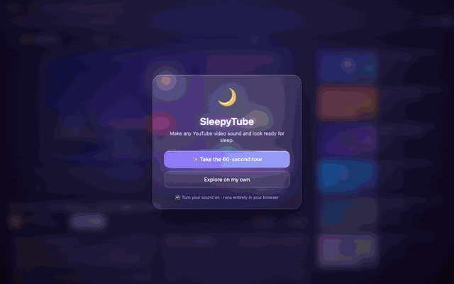

# SleepyTube 🌙

A Chrome extension (Manifest V3) that makes YouTube sound and look sleepy:
slowed, muffled, reverb and echo sound, a soft "hush" of background noise, a
sleep timer, and calming screen filters with a black screen mode.

[](https://kandekar007.github.io/sleepytube/demo/)
[](https://github.com/kandekar007/sleepytube/releases/latest)
[](https://buymeacoffee.com/adityakandekar)

[](https://github.com/kandekar007/sleepytube/releases)
[](https://hits.sh/github.com/kandekar007/sleepytube/)
[](https://github.com/kandekar007/sleepytube/stargazers)
<!-- Once published on the Chrome Web Store, add (replace EXTENSION_ID):
[](https://chromewebstore.google.com/detail/EXTENSION_ID)
-->



## Demo

- **[Try the live demo](https://kandekar007.github.io/sleepytube/demo/)**. It runs
  in your browser with nothing to install, and the sound is on. It uses the real
  popup and the real audio and screen engine on a mock YouTube page, with a lofi
  track composed live in your browser and a guided 60-second tour.
- **[Watch the video](demo/sleepytube-demo.mp4)**: a recording of the tour
  (76 s).

To run the demo locally, start a server from the repo folder and open
<http://localhost:8000/demo/>:

```sh
python3 -m http.server 8000
```

## Install

SleepyTube isn't on the Chrome Web Store yet, so you install it in developer mode.
This takes about a minute.

1. **Get the files**
   - **Download:** grab `sleepytube-x.y.z.zip` from the
     [latest release](https://github.com/kandekar007/sleepytube/releases/latest) and unzip it.
   - **Or clone:** `git clone https://github.com/kandekar007/sleepytube.git`
2. Open **`chrome://extensions`**. Edge (`edge://extensions`), Brave and other
   Chromium browsers work too.
3. Turn on **Developer mode** (top-right toggle).
4. Click **Load unpacked** and select the unzipped folder (the one containing
   `manifest.json`).
5. Pin SleepyTube from the 🧩 puzzle menu so its icon stays in the toolbar.
6. Open (or reload) a YouTube video, click the 🌙 icon and pick a mood. Open
   **Fine-tune** for every setting.

If the popup says "Click the YouTube page once to start", click anywhere on the
page. Chrome needs a user gesture before web audio can start.

Settings are shared by all YouTube tabs and saved automatically. The toggle in
the popup turns every sound and screen effect off instantly.

**Updating:** download or `git pull` the new version, then click ↻ on the
SleepyTube card in `chrome://extensions`.

## Sound effects (🎧 Sound tab)

- **Speed** – slows playback and lowers the pitch (the "slowed" sound)
- **Muffle** – low-pass filter, like hearing it through a wall
- **Warmth** – bass boost + softer treble
- **Reverb / Room size** – generated dark reverb, 1–8 s tails
- **8D drift** – sound slowly drifts left ↔ right
- **Echo / Delay / Repeats** – darkening feedback echo
- **Hush** – brown, pink, white or rain noise that only plays while the video plays
- **Volume** – output trim (a gentle compressor smooths peaks)
- **Presets** – Sleepy, Slowed + Reverb, Underwater, Next Room, Cathedral, Lo-fi Rain, Dreamy 8D
- **Sleep timer** – fades out over the last couple of minutes, then pauses the video

## Screen effects (🌙 Screen tab)

- **Black screen** – blacks out the whole page while the sound keeps playing.
  Move the mouse over it to show a **☀️ Show video** button (and the sleep
  countdown); it fades away again after a couple of seconds.
- **Dim** – darkens the page
- **Blue cut** – blue-light filter that warms the colours
- **Sepia** / **B&W** – old-photo tint or black and white
- **Soften** – gently blurs the video picture
- **Looks** – Off, Night, Candle, Dark, Sepia, B&W, Dreamy

Screen effects also work in fullscreen. The ↺ button resets only the tab you are on.

## Publishing

Run `./package.sh` to build `dist/sleepytube-<version>.zip`. It contains only
the extension files, without `demo/` or `store/`. Upload it in the
[Chrome Web Store Developer Dashboard](https://chrome.google.com/webstore/devconsole).
The listing text, permission justifications, screenshots and promo tiles are in `store/`.
Bump `version` in `manifest.json` before each update.

## Privacy

Everything runs on your device. SleepyTube has no accounts or tracking and sends
no data anywhere. It only runs on YouTube pages and only uses the `storage`
permission, to save your settings.

## Support

If SleepyTube helps you drift off, you can buy me a coffee:

<a href="https://buymeacoffee.com/adityakandekar"></a>

There's also a ☕ button in the popup header.
